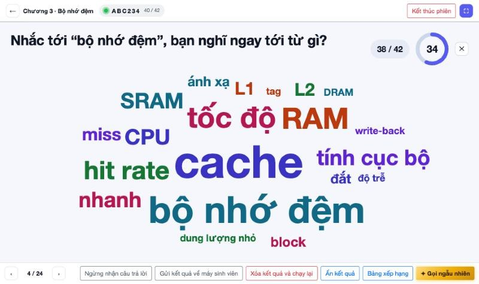
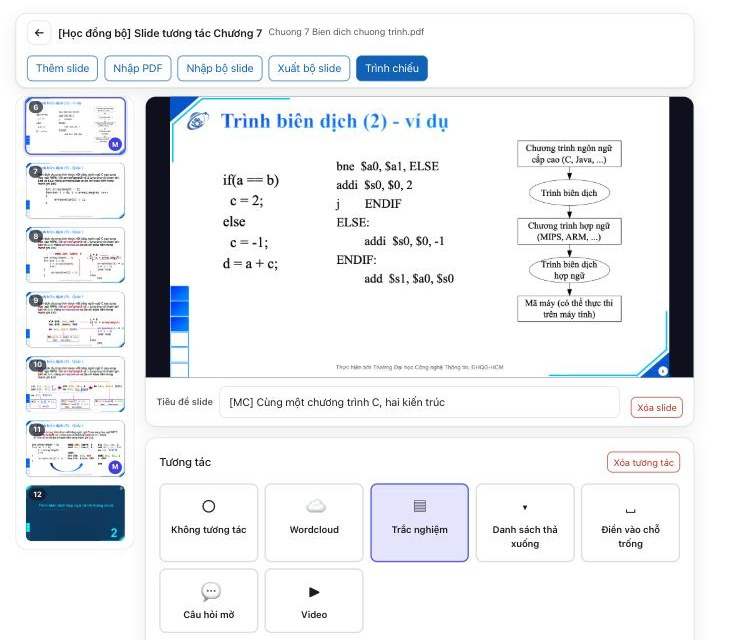
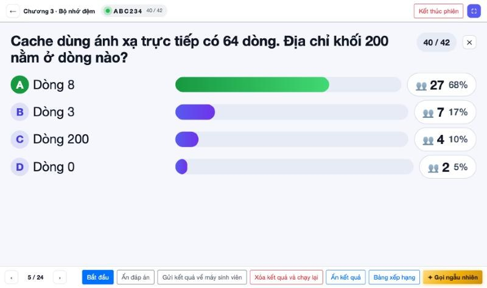
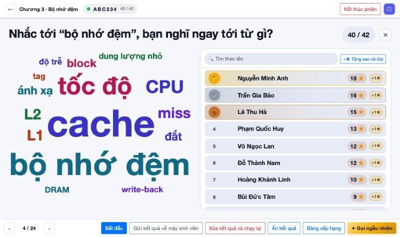
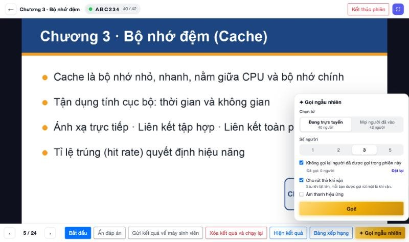
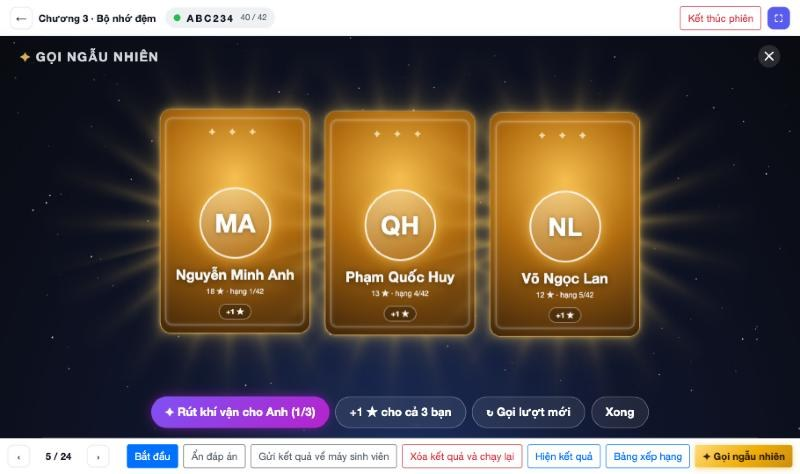
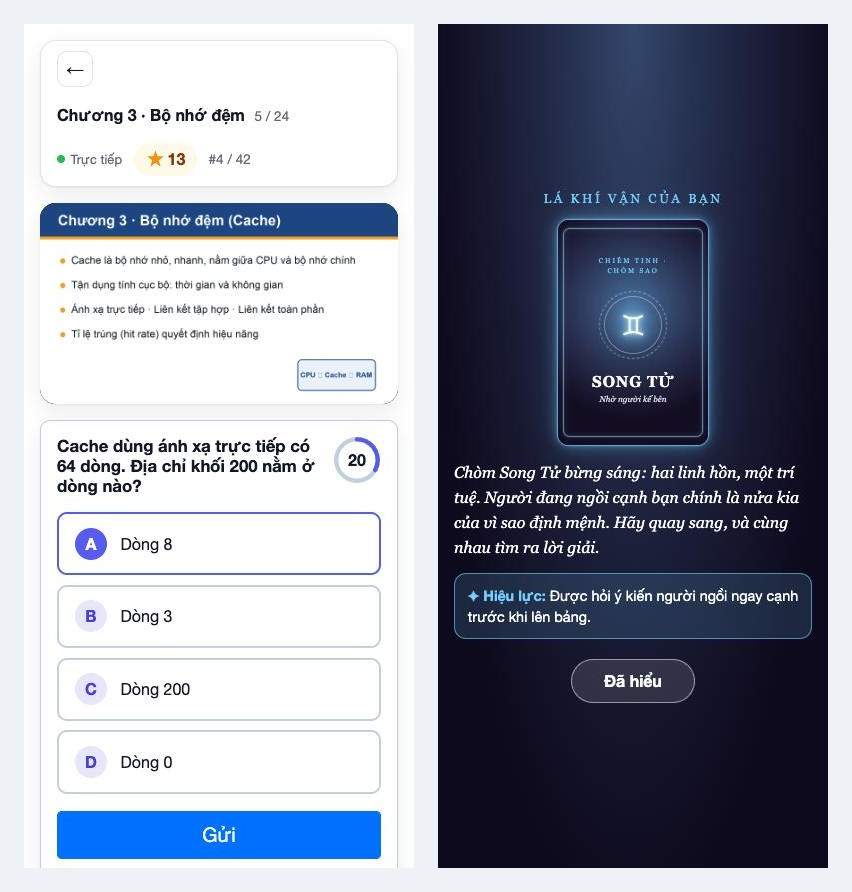
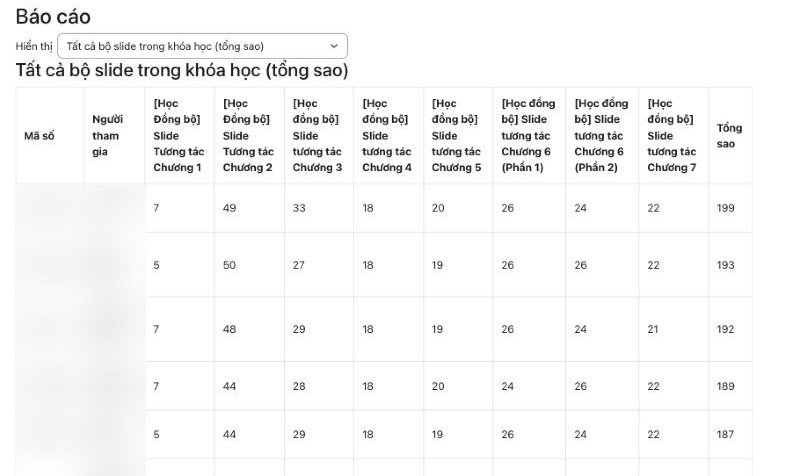
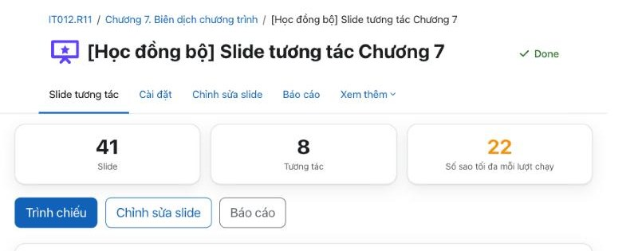

# Interactive Slide for Moodle

**Turn your PDF lecture into a class where everyone takes part, without leaving Moodle.**

Present your slides as usual. When you reach a slide with a question, press **Start**: students
answer on their phones, the results appear on the projector straight away, correct answers earn
⭐ stars, and at the end of the lecture the stars go into the Moodle gradebook by themselves.

No app to install, no account on another website, no codes to hand out: students simply open the
activity in their course, like any other Moodle activity.

---

## Why use it?

- 🎯 **Keep the room awake**: a short question every few slides gives everyone a reason to follow along.
- 👀 **See at a glance what the class understood**: one chart shows who got it and who is still confused.
- ⭐ **Motivate with stars and a leaderboard**: students enjoy watching their name climb the board.
- 📊 **Attendance and participation marks, done for you**: nothing to type in, it is all in the reports and the gradebook.
- 🧩 **Reuse the lectures you already have**: a PDF exported from PowerPoint is all it takes.
- 🏫 **Everything stays inside Moodle**: student data never leaves your institution's server.

---

## Get started in three steps

1. **Create the activity and import your slides.** Add an *Interactive Slide* activity to the
   course, then **Edit slides → Import PDF**. Each page of the PDF becomes a slide.
2. **Attach questions to slides.** Pick a slide, pick a question type, type the question and the
   answer. It saves as you go.
3. **Go to class and present.** **Present → Start session**, move through the deck with the arrow
   keys, and on a slide with a question press **Start** (or `Space`).

That's it. Students who open the activity on their phones see exactly the slide you are showing.

---

## Preparing a lecture

- **Import PDF** builds the whole deck in one go; drag slides to reorder them and delete the ones you don't need.
- **Add slide** from a picture (a screenshot, a photo of the whiteboard…) to slip in an extra page.
- Each slide can carry **one question**, and each question can have a **picture** (shown on the
  students' phones too) and a **video** (played on the projector only, for the room to watch together).
- Choose a **difficulty** (Easy / Medium / Hard) to set how many stars a question is worth, and add a **timer** if you like.

### Question types

| Type | Good for | On the projector |
|---|---|---|
| ☁️ **Word cloud** | Warm-ups, opinions, "what comes to mind?" | The more people type a word, the bigger it grows |
| ☑️ **Multiple choice** | Quick knowledge checks, one or several correct answers | A bar chart, with the right answer in green |
| 🔽 **Dropdown** | A sentence with several gaps, each filled from a list | A tally for every gap |
| ✏️ **Fill in the blanks** | Students type the answer themselves (a number, a term, a formula…) | The most common answers |
| 💬 **Open ended** | Discussion and opinions; students can attach a photo of work done on paper | A wall of answer cards |
| ▶️ **Video** | Showing a YouTube or Vimeo clip mid-lecture | The video plays on the projector |

**Fill in the blanks** marks answers sensibly: it ignores upper and lower case, extra spaces and a
full stop at the end, and treats an apostrophe typed on a phone the same as one typed on a laptop,
while keeping the characters that matter, such as the minus sign of a negative number.

---

## In class: the presenter screen

The presenter screen is what the room sees on the projector. The full-screen button gives the slide
the whole screen, on iPad too.

**You set the pace of every question:**

- **Start**: students answer; a countdown (if you set one) runs on the projector and on the phones.
- **Stop collecting**: answers close and stars go to everyone who got it right.
- **Reveal answer**: the correct answer lights up; **Send result to phones** lets students check it on their own screen.
- The live tally can stay **hidden while students answer**, so nobody just follows the crowd.
- The correct answer **never reaches a student's phone** before you reveal it.

**Pen and laser pointer**: draw, highlight and point on the slide with a mouse, a finger or a
stylus (pen pressure is supported, and a palm resting on the screen is ignored). Each slide keeps
its own drawing.

### Leaderboard and stars

- The leaderboard sits beside the result, with medals for the top three and a 🔥 for correct-answer streaks.
- **+1 ★** next to every name rewards a good spoken answer on the spot.
- **Stars for the class** gives everyone stars with a single button.
- Click the number next to an answer to see **who gave it**, and give them all stars at once.
  Handy when your own answer key turns out to be wrong: just credit everyone who answered correctly.
- **Search by name** without worrying about accents or word order: `an nguyen` finds *Nguyễn Văn An*.

---

## Call students to the board at random ✨

Instead of "any volunteers?", let luck decide. Call 1, 2, 3 or 5 students, from those online right
now or everyone who joined the session, and skip the ones already called.

Each name is revealed with a shooting-star card flip on the projector, and **the phone of every
student called gets the news too**.

Then each of them draws a **fortune card**: a playful tarot or horoscope prophecy with a real effect,
such as *ask your neighbour*, *choose a classmate to help you*, or *bonus stars*. A little luck takes
the pressure off going up to the board, and makes it a lot more fun.

---

## What students see

Students open the activity on a phone or a laptop. Before joining, they see the stars they have
collected in this activity and across the whole course. Once they join, the screen always follows
the slide you are presenting, with the question, the timer, and their own stars and rank.

- Ran out of time before pressing **Submit**? The answer they picked is sent automatically.
- Students can open **their own report** (and only their own).
- Your site can stop sending slide images to phones to save the lecture hall's Wi-Fi; phones are
  then answer pads while the room reads the projector.

---

## Inviting guests

A visiting class, a colleague sitting in, an open day for prospective students? Turn on
**Invite guests**, put the **QR code** on the projector, and visitors scan it, type their name and
join in like everyone else. Guests appear on the leaderboard (marked *Guest*) but **never affect
the grades** of the enrolled students. Every session has its own link; last week's code opens nothing.

---

## Stars, grades and reports

*(Student ID numbers and names are blurred in this picture.)*

- **How stars are earned:** a correct answer earns stars according to the question's difficulty
  (by default Easy = 1, Medium = 2, Hard = 3), with an optional **speed bonus** for answering quickly.
  Questions with no right answer (word cloud, open ended) reward everyone who takes part. Joining
  a session earns stars too.
- **Three reports:** every activity in the course (one column per chapter, plus the semester
  total), one activity across all its sessions, or one session question by question.
- Every report starts with the **student ID number and name**, so it lines up with your class list.
  **Download** it as Excel, CSV, ODS and more.
- **Straight into the Moodle gradebook** when a session ends, using one of four rules: total stars
  against the sessions attended, best single session, most recent session, or relative to the top student.

---

## Sharing a deck with colleagues

**Export deck** saves every slide, picture and question into a single `.zip` file. A colleague
simply uses **Import deck** in their own activity, on the same Moodle site or a different one. The
file holds lecture content only: no student answers and no grades.

---

## For Moodle administrators

- **Requirements:** Moodle 4.3 or later, including Moodle 5.x.
- **Installation:** *Site administration → Plugins → Install plugins*, upload the plugin ZIP and
  follow the upgrade steps. Nothing else needs installing on the server: PDFs are turned into slide
  images in the teacher's own browser.
- **Site-wide settings** (stars per difficulty, update interval, whether guests may be invited…)
  live under *Site administration → Plugins → Activity modules → Interactive Slide*.
- **Privacy:** full support for Moodle's Privacy API (export and deletion of a user's data on
  request). Data is included in course backup and restore.
- Comes with **English** and **Vietnamese** language packs; the interface follows each user's language.

---

*The screenshots show the Vietnamese language pack. The presenter and phone screens use sample data
with made-up names.*

## Licence

GPL v3 or later, the same as Moodle.
